# ER diyagramı

Kod: `api/src/AIGuard.Domain/Entities` ve `api/src/AIGuard.Infrastructure/Persistence/Configurations`. Son göç: `20261119204838_GabUyumu`.

Model değiştiğinde diyagram da aynı PR'da güncellenmeli. Tablo ve sütun adları veritabanındaki snake_case adlar; kararların gerekçeleri [MIMARI-KARARLAR.md](MIMARI-KARARLAR.md) dosyasında.

Gösterim: `PK` birincil anahtar, `FK` yabancı anahtar, `UK` benzersiz. `||--o{` bire-çok, `||--o|` bire-sıfır/bir.

```mermaid
erDiagram
    users ||--o{ refresh_tokens : "sahip"
    users ||--o{ exam_assignments : "atanır"
    users ||--o{ consent_records : "verir"
    users ||--o| reference_face_templates : "sahip (aday)"
    users ||--o{ exam_sessions : "aday"
    users ||--o{ reviewer_decisions : "değerlendirici"
    users ||--o{ audit_logs : "yapan"
    users ||--o{ events : "yanlış alarm işaretleyen"

    exams ||--o{ questions : "içerir"
    exams ||--o{ exam_assignments : "içerir"
    exams ||--o{ exam_sessions : "içerir"
    exams ||--o{ risk_settings : "sınav bazında ayar"

    exam_sessions ||--o{ answers : "1-N"
    exam_sessions ||--o{ events : "1-N"
    exam_sessions ||--o{ verifications : "1-N"
    exam_sessions ||--o{ consent_records : "oturum rızası"
    exam_sessions ||--o| agent_pairings : "0..1 (ajansızsa yok)"
    exam_sessions ||--o| reviewer_decisions : "0..1"

    questions ||--o{ answers : "cevaplanır"
    events ||--o| evidence_frames : "0..1"
    agent_pairings ||--o{ agent_signals : "1-N"
    consent_records ||--o{ reference_face_templates : "dayanak"

    users {
        uuid id PK
        varchar full_name
        varchar email
        varchar normalized_email UK
        varchar password_hash "null = davet bekliyor"
        varchar role "Admin | Reviewer | Candidate"
        bool is_active
        varchar invite_token_hash UK "SHA-256"
        timestamptz invite_expires_at
        timestamptz invite_accepted_at
        int failed_login_count
        timestamptz lockout_end_at
        timestamptz created_at
    }

    refresh_tokens {
        uuid id PK
        uuid user_id FK
        varchar token_hash UK "SHA-256"
        timestamptz created_at
        timestamptz expires_at
        timestamptz revoked_at
        uuid replaced_by_token_id
    }

    exams {
        uuid id PK
        varchar name
        varchar type "GeneralAptitude | EnglishProficiency"
        int duration_minutes "CHECK > 0"
        timestamptz window_start_at
        timestamptz window_end_at "CHECK > start"
        int retention_days "CHECK > 0"
        timestamptz created_at
    }

    questions {
        uuid id PK
        uuid exam_id FK
        text text
        text_array options "CHECK >= 2"
        int correct_option_index "adaya gönderilmez"
        int order
    }

    exam_assignments {
        uuid id PK
        uuid exam_id FK "UK (exam_id, user_id)"
        uuid user_id FK
        varchar role "Candidate | Reviewer"
        timestamptz assigned_at
        timestamptz attempt_used_at "oturum hakkı kullanıldı"
    }

    exam_sessions {
        uuid id PK
        uuid exam_id FK "UK (exam_id, candidate_id), iptal edilenler hariç"
        uuid candidate_id FK
        varchar state "SessionState"
        int flags "Risky=1 Indicated=2 NoAgent=4 MonitoringGap=8 PermissionGap=16"
        timestamptz created_at
        timestamptz started_at
        timestamptz ends_at "sunucu saati"
        timestamptz ended_at
        inet initial_ip_address
        float risk_score
        int verification_attempts
        varchar continue_justification
        xid xmin "iyimser kilit"
    }

    answers {
        uuid id PK
        uuid exam_session_id FK "UK (exam_session_id, seq)"
        uuid question_id FK
        int selected_option
        bigint seq
        timestamptz client_time "güvenilmez"
        timestamptz received_at
        bool unmonitored
    }

    consent_records {
        uuid id PK
        uuid user_id FK
        uuid exam_session_id FK "yalnızca Session türünde"
        varchar type "Biometric | Session"
        varchar text_version
        timestamptz granted_at
        timestamptz withdrawn_at
    }

    reference_face_templates {
        uuid id PK
        uuid user_id FK,UK
        bytea encrypted_vector "AES-GCM, en fazla 8 KB"
        int key_version
        uuid consent_record_id FK
        timestamptz created_at
    }

    verifications {
        uuid id PK
        uuid exam_session_id FK
        varchar kind "Initial | Reconnect | Periodic"
        float liveness_score
        float similarity
        bool passed
        timestamptz created_at
    }

    events {
        uuid id PK
        uuid exam_session_id FK
        varchar type "EventType"
        varchar source "Camera | Audio | Browser | Device | Network | System"
        timestamptz started_at
        float duration_sec
        float confidence "0-1"
        jsonb payload
        float score_contribution
        varchar reason "Türkçe gerekçe"
        timestamptz received_at "A6 gecikme"
        bool is_false_alarm
        uuid false_alarm_marked_by_id FK
        timestamptz false_alarm_marked_at
    }

    evidence_frames {
        uuid id PK
        uuid event_id FK,UK
        varchar storage_key UK "dosya deposu, şifreli"
        int key_version
        timestamptz created_at
        timestamptz delete_after
    }

    agent_pairings {
        uuid id PK
        uuid exam_session_id FK,UK
        varchar pairing_code_hash UK "SHA-256"
        timestamptz pairing_code_expires_at
        timestamptz paired_at
        varchar platform "Windows | MacOS"
        bytea encrypted_session_key "kullanılmıyor (S-16)"
        varchar session_key_hash "SHA-256, HMAC anahtarının özeti (Y2)"
        timestamptz last_signal_at
    }

    agent_signals {
        uuid id PK
        uuid agent_pairing_id FK "UK (agent_pairing_id, nonce)"
        timestamptz signed_at
        varchar nonce
        timestamptz received_at
        bool signature_valid
        jsonb indicators "yalnızca eşleşenler"
    }

    risk_settings {
        uuid id PK
        uuid exam_id FK "null = sistem geneli"
        varchar event_type "UK (exam_id, event_type) NULLS NOT DISTINCT"
        float weight
        float decay
        float threshold
    }

    reviewer_decisions {
        uuid id PK
        uuid exam_session_id FK,UK
        uuid reviewer_id FK
        varchar decision "Clean | Suspicious | Violation"
        varchar note
        timestamptz decided_at
    }

    audit_logs {
        uuid id PK
        uuid actor_user_id FK "null = sistem"
        varchar action
        varchar target_type
        uuid target_id
        jsonb old_value
        jsonb new_value
        timestamptz occurred_at
    }
```

## Durum alanı

`exam_sessions.state` değerleri: `ConsentPending`, `AgentPairing`, `IdentityVerification`, `InProgress`, `PermissionPending`, `Disconnected`, `Completed`, `Cancelled`, `Decided`. Geçiş tablosu E4 kartındaki durum makinesindedir.

## Olay türleri

`events.type` değerleri: `FACE_MISSING`, `MULTIPLE_FACES`, `GAZE_AWAY`, `PHONE`, `IDENTITY_MISMATCH`, `VERIFICATION_FAILED`, `SPEECH`, `TAB_BLUR`, `FULLSCREEN_EXIT`, `COPY_PASTE`, `RIGHT_CLICK`, `PERMISSION_REVOKED`, `VM_DETECTED`, `HYPERVISOR_INFO`, `FORBIDDEN_APP`, `VPN_PROXY`, `IP_CHANGE`, `AGENT_SIGNAL_LOST`, `AGENT_SIGNAL_INVALID`, `CONNECTION_LOST`, `MONITORING_GAP`.
