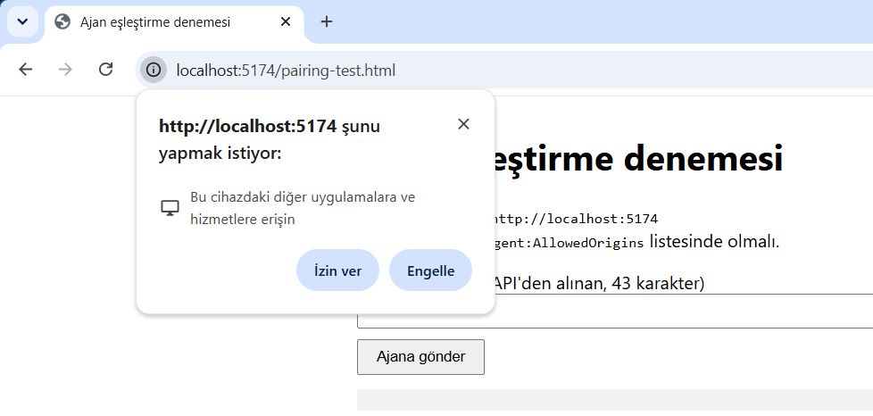

# Y1 · Tarayıcı deneme notları (yerel ağ erişimi)

Platform sitesindeki sayfa, kodu `http://127.0.0.1:47321/pair` adresindeki ajana gönderiyor. Tarayıcılar, bir web sitesinin kullanıcının bilgisayarındaki (loopback) veya yerel ağdaki bir adrese istek atmasını giderek daha sıkı denetliyor. Bu belge Chrome, Edge ve Firefox'ta bu isteğin nasıl davrandığını not etmek için.

*Son güncelleme: 20 Kasım 2026 (Y1 revizyonu)*

## Ajan tarafında yapılanlar

| Kural | Neden |
|---|---|
| Yalnızca `127.0.0.1:47321` dinleniyor | Ağdaki başka bir bilgisayar ajana bağlanamaz; kod tarayıcıdan ajana yalnızca bu yoldan gelir |
| Origin `Agent:AllowedOrigins` listesinde değilse 403 | CORS başlığı yalnızca yanıtın okunmasını engeller, isteği değil; izinsiz site kod gönderemesin |
| Origin başlığı yoksa 403 | Eşleştirme yalnızca tarayıcıdan |
| `Host` başlığı `127.0.0.1` veya `localhost` değilse 400 | DNS rebinding: kötü niyetli bir alan adı 127.0.0.1'e çözülse bile reddedilir |
| Ön kontrol (OPTIONS) yanıtında `Access-Control-Allow-Private-Network: true` | Chrome'un Private Network Access kuralı (kart) |
| Yalnızca `application/json` gövde | `text/plain` gibi "basit" istekler ön kontrolsüz gider; JSON zorunlu olunca her istekte ön kontrol yapılır |

## Komut satırıyla doğrulananlar (20 Kasım 2026, Windows 11)

API Docker'da (Development), ajan Windows'ta (`aiguard-agent.exe`) çalışırken `curl` ile:

| Deneme | Sonuç |
|---|---|
| `netstat`: dinlenen adres | yalnızca `127.0.0.1:47321` |
| Bilgisayarın ağ IP'si (`192.168.56.1:47321`) üzerinden bağlanma | bağlantı kurulamadı |
| İzinsiz origin'den `POST /pair` | 403, kod sunucuya gitmedi |
| İzinli origin'den ön kontrol | 204, `Access-Control-Allow-Origin` ve `Access-Control-Allow-Private-Network: true` var |
| İzinli origin'den `POST /pair` | 200 `{"status":"paired"}`, veritabanında `paired_at` dolu, yalnızca kodun özeti saklı |
| Aynı kodla ikinci `POST /pair` | 409 `{"status":"rejected"}` |

## Tarayıcı denemesi nasıl yapılır

1. API'yi Development ortamında çalıştır (README: yerel kurulum veya Docker).
2. Ajanı çalıştır: `cd agent && dotnet run --project src/AIGuard.Agent.Windows` (macOS'ta `AIGuard.Agent.MacOS`). `appsettings.json` içindeki `AllowedOrigins` varsayılanı `http://localhost:5173`.
3. Test sayfasını sun: `python -m http.server 5173 --bind 127.0.0.1 -d agent/tools` ve tarayıcıda `http://localhost:5173/pairing-test.html` adresini aç.
4. Bir oturum için kod al (E2 gelene kadar uç yalnızca Development'ta açık):
   ```bash
   curl -X POST http://localhost:5080/api/sessions/<oturum-id>/agent-code
   ```
5. Yanıttaki `code` değerini sayfaya yapıştır, "Ajana gönder"e bas. Kod 5 dakika geçerli ve tek kullanımlık. Oturum `AgentPairing` durumunda olmalı.
6. DevTools > Network'te `OPTIONS` ve `POST` isteklerini, Console'da varsa uyarıları not et.

**İzin istemini görmek için sayfa genel (public) bir adresten açılmalı.** `localhost` → `127.0.0.1` isteği tarayıcı için aynı adres alanında kalıyor; istem çıkmaz. Denemede genel adres yerine Chrome'un `--ip-address-space-overrides=127.0.0.1:<port>=public` açılış seçeneği kullanıldı: tarayıcı sayfayı internetten geliyormuş gibi değerlendiriyor ve gerçek sınav sitesindeki istem çıkıyor.

## Windows denemesi (20 Kasım 2026)

**Ortam:** Windows 11. Y1 dalındaki API (Docker, compose'daki PostgreSQL ile) ve `aiguard-agent.exe` kullanıldı. Ajanın izinli origin'i `http://localhost:5174`, izinsiz origin olarak `http://localhost:5175` denendi. Tarayıcılar bilgisayarda kurulu Chrome ve Edge; her senaryo yeni ve temiz bir tarayıcı profiliyle Playwright üzerinden açıldı. İstekler test sayfasının yaptığı `fetch` ile aynı. Tarayıcının kendi arayüzündeki istem ekran görüntüsüyle kaydedildi.

| Tarayıcı / sürüm | Senaryo | İzin istemi | Sonuç | Not |
|---|---|---|---|---|
| Chrome 157.0.8103.79 | İzinli origin, yerel sayfa (`localhost:5174`) | Çıkmadı | 200 `paired`, 17 ms | Yerelden yerele istekte istem yok |
| Chrome 157.0.8103.79 | İzinsiz origin (`localhost:5175`) | Çıkmadı | `TypeError: Failed to fetch` | Konsolda CORS hatası; ajan 403 verdi, kod sunucuya gitmedi |
| Chrome 157.0.8103.79 | Genel site gibi (`public`), izin verilmeden | **Çıktı** (görüntü aşağıda) | İstek, istem yanıtlanana kadar bekledi. İstem çıktıktan sonra **İzin ver**'e basıldı ve 7,4 sn'de 200 `paired` geldi | Yanıtlanmadan istek zaman aşımına uğramıyor, bekliyor |
| Chrome 157.0.8103.79 | Genel site gibi, izin önceden verilmiş | Çıkmadı | 200 `paired` | İzin DevTools ile (`localNetworkAccess`) önceden verildi |
| Edge 157.0.4341.60 | İzinli origin, yerel sayfa | Çıkmadı | 200 `paired`, 19 ms | |
| Edge 157.0.4341.60 | İzinsiz origin | Çıkmadı | `TypeError: Failed to fetch` | Konsolda CORS hatası |
| Edge 157.0.4341.60 | Genel site gibi, izin verilmeden | **Çıktı** (Chrome'la aynı yerde izin balonu) | 12 sn boyunca yanıt gelmedi, istek istemi bekledi | Otomasyon altında balonun içi çizilmedi; metin elle bakılarak doğrulanmalı |
| Edge 157.0.4341.60 | Genel site gibi, DevTools ile izin verilmiş | **Yine çıktı** | 12 sn boyunca yanıt gelmedi | Edge, Chrome'un DevTools izin ayarını dikkate almadı. **İzin ver**'e elle basıldığında sonuç ayrıca denenmeli |
| Firefox | — | — | Denenmedi | Bilgisayarda Firefox kurulu değil |

Chrome 157'deki istem:



**Sonuçlar:**

- Eşleşme Chrome ve Edge'de kuruluyor. İzinsiz bir sitenin isteği iki tarayıcıda da CORS ile engelleniyor ve ajan kodu sunucuya göndermiyor.
- Gerçek sınav sitesi (genel bir HTTPS adres) ajana ilk istekte Chrome ve Edge'de izin istemi çıkarıyor. Chrome'daki metin: **"Bu cihazdaki diğer uygulamalara ve hizmetlere erişin"**, düğmeler **İzin ver / Engelle**.
- İstem yanıtlanana kadar `fetch` bekliyor, hata vermiyor. Önyüz bu yüzden kendi zaman aşımını koymalı.
- `Access-Control-Allow-Private-Network` başlığı hâlâ gönderiliyor. Chrome 157 artık izin istemiyle çalışıyor, başlık zararsız.
- **Karma içerik:** `https://` sayfadan `http://127.0.0.1` adresine istek Chrome ve Edge'de izinli, çünkü `127.0.0.1` "güvenilir kaynak" sayılıyor. Bu, yerel sayfayla denendi; HTTPS ile ayrıca denenmedi.

**Eksik kalanlar:**

- Edge'de **İzin ver**'e elle basılınca eşleşmenin kurulduğu.
- Edge istem metni.
- Firefox denemesi; kurulduktan sonra yapılacak.

## Web önyüzü için notlar (Şeyma, S2)

Kart Y1, Chrome izin isteminin sonucunun aday ekranındaki yönlendirme metni için S2'ye iletilmesini istiyor. Denemeye göre öneri:

> Sınav güvenlik uygulamasıyla bağlantı kuruluyor. Tarayıcınız **"Bu cihazdaki diğer uygulamalara ve hizmetlere erişin"** izni isterse **İzin ver**'i seçin. Yanlışlıkla **Engelle**'yi seçtiyseniz adres çubuğunun solundaki simgeye tıklayıp izni açın ve sayfayı yenileyin.

- İstem yanıtlanana kadar `fetch` beklediği için önyüz isteğe zaman aşımı (ör. 30 sn, `AbortController`) koymalı ve süre dolunca bu yönlendirmeyi göstermeli.
- İstem yalnızca ilk seferde çıkıyor; izin site için hatırlanıyor.

Diğer notlar:

- Kod adaya gösterilmez, konsola veya hata mesajına yazılmaz.
- Ajan yanıtları: `200 paired`, `409 rejected` (yeni kod alıp tekrar dene), `502 unavailable` (sunucuya ulaşılamadı), `403` (sayfanın origin'i ajanın listesinde yok). Ajan kapalıysa `fetch` hata fırlatır (Y4: ajansız devam akışı).
- İzin istemi reddedildiğinde `fetch` ile "ajan kapalı" durumu tarayıcıda ayırt edilemiyor; adaya ikisi için de "izni kontrol et / ajanı başlat" yönlendirmesi gösterilmeli.
